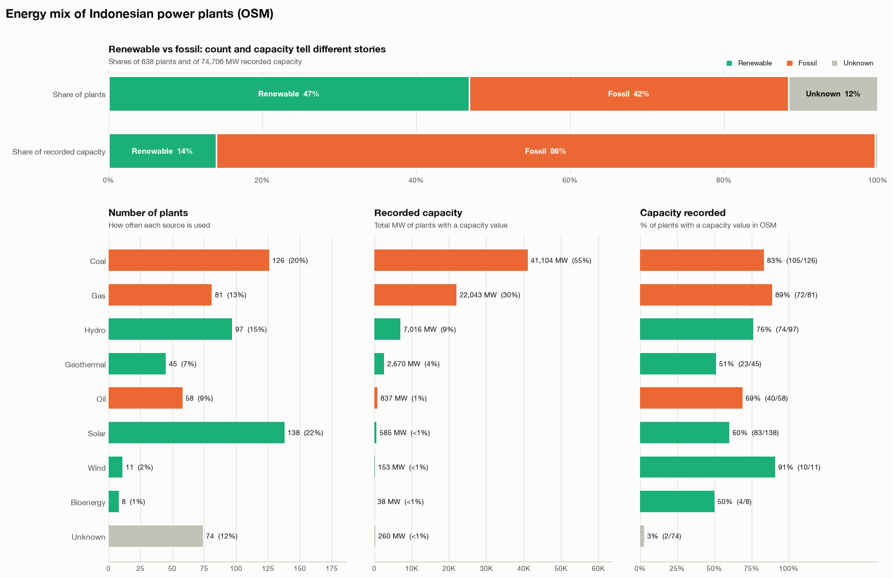
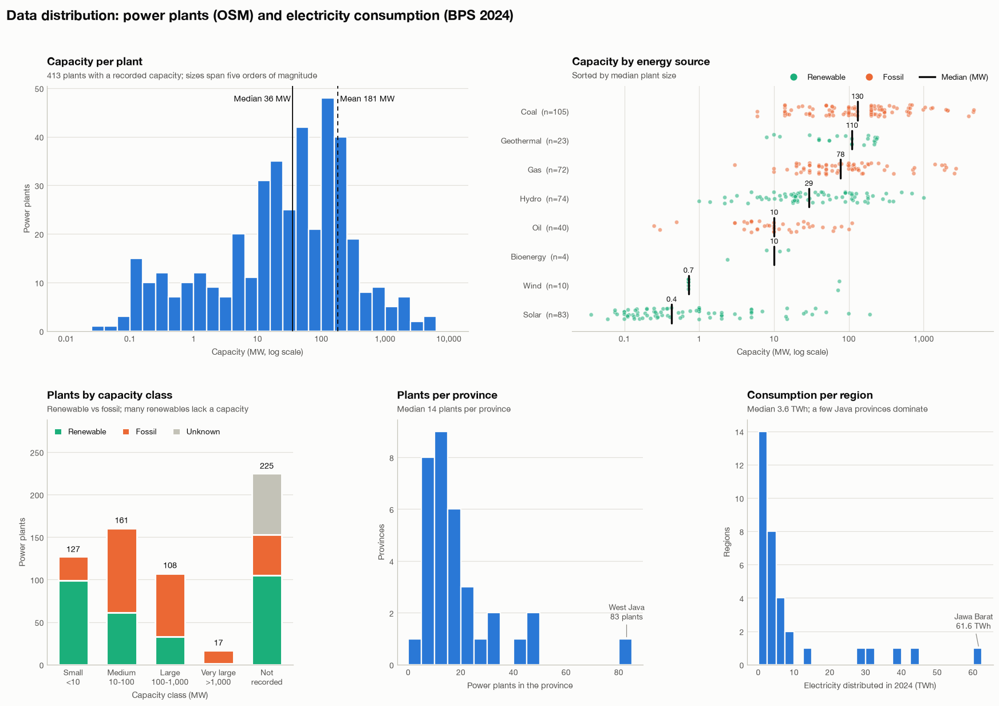
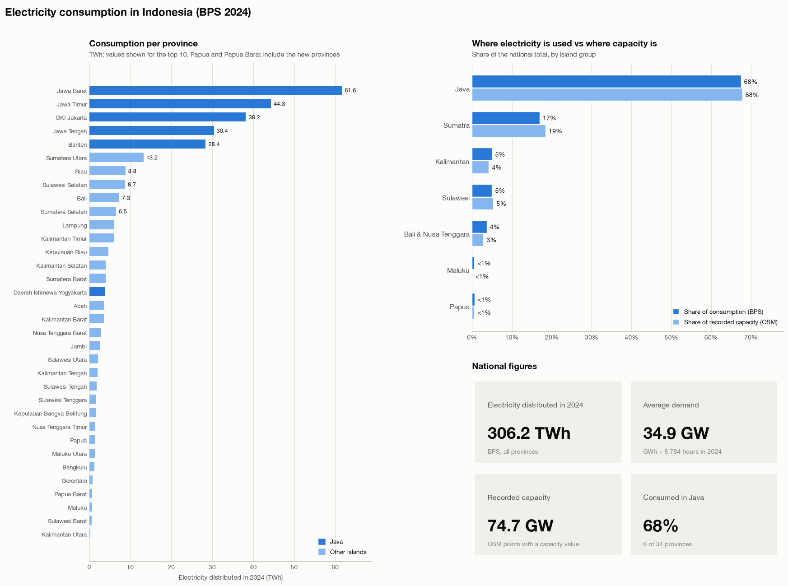
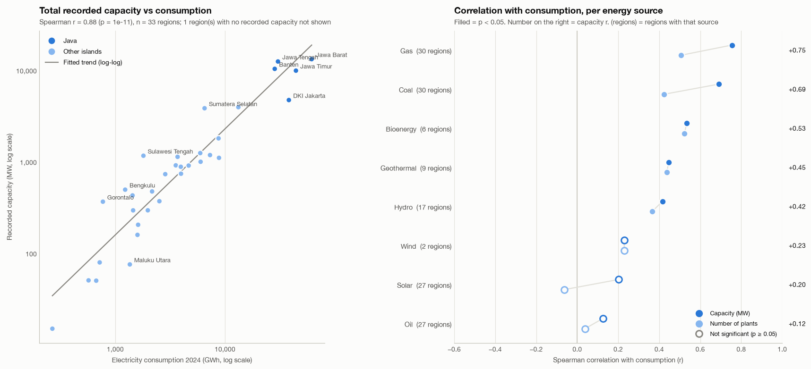
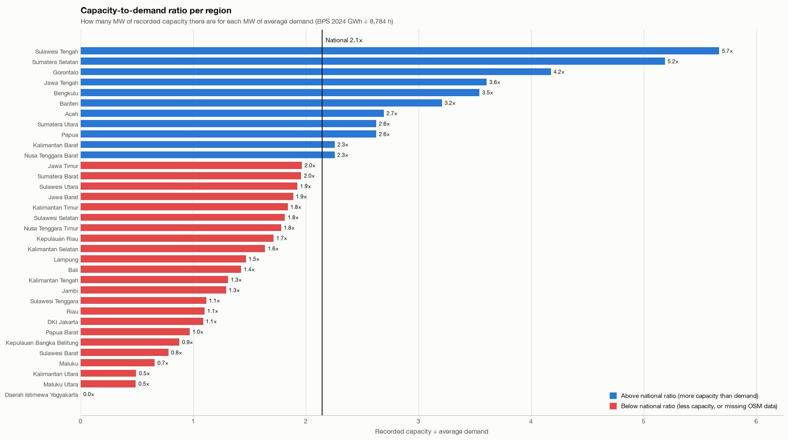
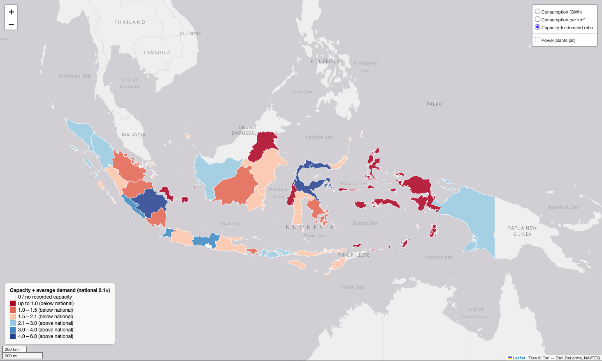

# Energy Mix of Indonesian Power Plants

**Author:** Yana Wicaksana

Electricity is one of the basic needs for development, and related to the energy transition, this study looks at the energy mix of power plants in Indonesia. Almost half of the power plants use renewable energy, but they produce only **14%** of the power. Coal and gas plants are fewer, but they provide about **85%** of the power. Solar has the most plants, but most of them are small, so together they add less than **1%**. This shows that clean energy is growing in number, but not yet in capacity. *(Based on OpenStreetMap data.)*



---

## Data distribution

Looking at the data distribution, the size of power plants in Indonesia is very different from one to another, from less than 0.1 MW to more than 4,000 MW. The typical plant is **36 MW**, but the average is **181 MW** because a few very large plants pull it up. Coal plants are the biggest, with a typical size of 130 MW, while solar plants are only about 0.4 MW.

Power plants and electricity use are also not spread evenly: a typical province has **14 plants** and uses **3.6 TWh**, but West Java has **83 plants** and uses **61.6 TWh**. This shows that both power plants and electricity demand are concentrated in a few provinces, especially in Java. *(Based on OpenStreetMap and BPS 2024 data.)*



---

## Electricity consumption

For electricity consumption, Indonesia used **306.2 TWh** in 2024, and **68%** of it was used in Java, which has only 6 of the 34 provinces. Java also has **68%** of the recorded power plant capacity, so the capacity is built where the electricity is used.

The same pattern is seen in other provinces: the more electricity a province uses, the more capacity it has. Gas and coal plants follow electricity demand most closely, while solar and oil plants show almost no link. Jakarta is an exception, because it uses a lot of electricity but has less capacity, so it likely gets power from the neighbouring provinces. *(Based on OpenStreetMap and BPS 2024 data.)*





---

## Capacity compared with demand

To compare power plant capacity with electricity demand, I calculated how many MW of capacity there are for each MW of average demand, and nationally the ratio is **2.1**. Central Sulawesi (**5.7**) and South Sumatra (**5.2**) have the highest ratio, likely because of large coal plants that serve the nickel industry and coal mining areas. On the other hand, Maluku, North Maluku and North Kalimantan have less than 1 MW for each MW of demand, and Yogyakarta has no recorded capacity at all.

The map shows that many regions with a low ratio are in eastern Indonesia. However, a low ratio can also mean that the power plant data in OpenStreetMap is not complete yet. *(Based on OpenStreetMap and BPS 2024 data.)*





---

## Conclusion

In conclusion, electricity in Indonesia is still very concentrated in Java, both for the power plants and for the electricity use. The capacity generally follows the demand, and it is mainly supported by large coal and gas plants. Renewable energy plants are already many in number, but most of them are still small, so their contribution to capacity is low. Some regions, especially in eastern Indonesia, have less capacity compared with their demand, which can be a concern for the future or a sign that the data is not complete yet.

For the next step, this analysis can be improved with official data from PLN or ESDM and with population data, to get a more complete picture of electricity access in Indonesia.

---

## Sources

- **Power plant locations, energy source and capacity:** OpenStreetMap contributors ([ODbL](https://opendatacommons.org/licenses/odbl/)), objects tagged `power=plant` in Indonesia, retrieved through the Overpass API on 7 November 2026.
- **Electricity consumption:** Badan Pusat Statistik (BPS), [*Listrik yang Didistribusikan Menurut Provinsi (GWh)*](https://www.bps.go.id/id/statistics-table/2/ODU5IzI=/listrik-yang-didistribusikan-menurut-provinsi--gwh-.html), 2024 (preliminary figures), updated 23 January 2026.
- **Province boundaries:** [geoBoundaries](https://www.geoboundaries.org/) gbOpen, Indonesia ADM1 (CC BY 4.0).
- **Basemap for the interactive maps:** Leaflet with tiles © Esri (Esri, DeLorme, NAVTEQ).
- **Analysis:** Python with Pandas, NumPy, GeoPandas, SciPy, Matplotlib, rasterio and folium.

---

## About the notebook

All figures above are produced by [`Power_Plant_Distribution_Indonesia.ipynb`](Power_Plant_Distribution_Indonesia.ipynb).

| Section | Content |
|---|---|
| 2.1–2.4 | Data preparation and cleaning: deduplication, coordinate checks, standardising energy sources (including filling sources from plant name abbreviations such as PLTU, PLTA, PLTS) and converting capacity text in different units to MW |
| 2.5–2.9 | Point geometries, geometry validation, CRS management (equal-area EPSG:6933), province areas and centroids, spatial join of plants to provinces |
| 2.10 | Joining BPS electricity consumption (province name standardisation, new Papua provinces merged with their parents) |
| 2.11 | Data distribution |
| 2.12 | Energy mix |
| 2.13 | Electricity consumption |
| 2.14 | Correlation between capacity and consumption, capacity-to-demand ratio |
| 2.15 | Raster analysis: capacity density surfaces on a 5 km grid |
| 2.16 | Interactive maps |
| 2.17 | Export to CSV, GeoJSON, GeoPackage, GeoTIFF and HTML |

### Interactive maps

Three interactive maps with switchable layers are saved in [`output/`](output/):

| File | Layers |
|---|---|
| `map_1_power_plants_by_source.html` | Plants per energy source, all fossil / all renewable, capacity density, province and national borders |
| `map_2_capacity_by_province.html` | Coal, gas, fossil, renewable and total capacity per province, renewable share, plant density |
| `map_3_consumption.html` | Electricity consumption, consumption per km², capacity-to-demand ratio, optional plant overlay |

GitHub does not display interactive maps: download the HTML files and open them in a browser, or publish the repository with GitHub Pages.

### How to run

```bash
python -m venv .venv
source .venv/bin/activate        # Windows: .venv\Scripts\activate
pip install -r requirements.txt
```

Open the notebook in VS Code or Jupyter and run all cells. In Google Colab, upload the notebook and the `data/` folder and run `%pip install rasterio folium` first.

### Project structure

```
├── Power_Plant_Distribution_Indonesia.ipynb   # the analysis
├── data/                                       # OSM power plants, province boundaries, BPS consumption
├── output/                                     # CSV, GeoJSON, GeoPackage, GeoTIFF and HTML maps
├── images/                                     # figures used in this README
└── requirements.txt
```

### Limitations

- OSM is not a complete inventory: about a third of the plants have no recorded capacity, so the MW figures describe the mapped plants, not official national installed capacity.
- Capacity is used as a proxy for production; electricity also flows between provinces through the grid.
- BPS reports electricity *distributed* by PLN, which excludes power that industries produce for themselves.
